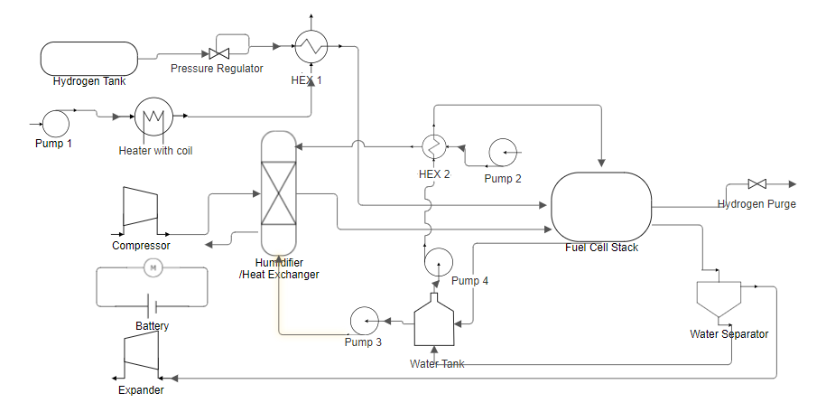
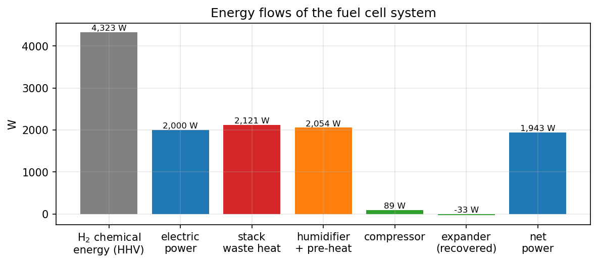
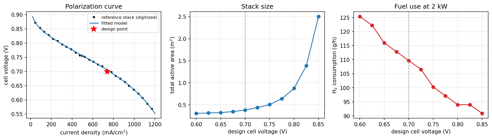

# PEM Fuel Cell System Design for a Small Electric Boat

Design of a **2 kW hydrogen PEM fuel cell system** to power a two-person boat. The design covers:
- sizing the stack from a polarization curve,
- mass and energy balances of the stack,
- the supporting equipment around it (air compressor, humidifier, expander, hydrogen pre-heater, pumps),
- heat integration and the net power and efficiency of the whole system.

The design is built as an **Excel model**. A **Python / Jupyter** notebook reproduces it and studies how the operating
cell voltage should be chosen.

*Course project – ChE 444 Fuel Cells, Boğaziçi University, Fall 2023. Group project with Feriha Mesra Aktaş, Çağlasu
Bakır and Sıla Dönmez.*



## Design basis

| | |
|---|---|
| Application | 4.8 m × 2 m boat, 2 passengers, 13–15 km/h (after Tang et al., 2006) |
| Stack | **2 kW at 24 V**, PEM, 80 °C, 5 psig (1.36 bar) |
| Fuel and oxidant | dry hydrogen in dead-end mode (from a 200 bar tank); air at oxygen stoichiometry 2.5, humidified to saturation |
| Cell voltage | 0.70 V, giving 740 mA/cm² on the reference polarization curve |

## Results

| | |
|---|---|
| Stack current | 83.3 A |
| Cells × active area | **35 cells × 113 cm²** |
| Stack efficiency (HHV) | 47.2 % |
| Hydrogen consumption | 0.0305 g/s (110 g/h) |
| Air flow | 2.60 g/s, plus 0.87 g/s water vapour after humidification |
| Product water | 0.27 g/s; 0.20 g/s condenses in the exhaust and is recovered |
| Heat removed from the stack | 2.12 kW (coolant flow 68 g/s for a 7.5 °C rise) |
| Air compressor | 89 W; air leaves at 54 °C |
| Cathode-exhaust expander | recovers 33 W |
| Humidifier | 0.85 g/s water, 2.03 kW heat |
| **Net power** | **1.94 kW** |
| **System efficiency (HHV)** | **45.9 %** |



**Heat integration.** Humidifying the air and pre-heating the hydrogen need 2.05 kW of heat, and the stack rejects
2.12 kW. The stack coolant is routed through the humidifier water tank and the hydrogen pre-heater, so the stack's own
waste heat covers about 97 % of the duty. No electric heating is needed, and the only significant parasitic load is the
air compressor.

## Choosing the cell voltage (notebook)

The reference polarization curve is fitted with the standard semi-empirical model (1.4 mV RMS error). The design is
then repeated for cell voltages from 0.60 to 0.85 V:
- **A higher cell voltage gives a more efficient stack but a much bigger one.** At 0.80 V instead of 0.70 V, hydrogen
  use drops by 14 %, but the active area grows 2.3×.
- **System efficiency peaks at about 0.725 V.** A more efficient stack rejects less heat. Above that voltage the waste
  heat no longer covers humidification, and electric heating cancels the gain. The chosen **0.70 V** is close to this
  optimum and keeps the stack compact.
- **Hydrogen storage drives the boat's volume budget.** A 4-hour trip at full power needs about **0.44 kg of H₂**,
  roughly 30 L of tank volume at 200 bar.



## Repository structure

```
excel/
  fuel_cell_boat_design.xlsx      the design model (all formulas)
notebook/
  fuel_cell_system_design.ipynb   Python model, check against the Excel model, operating-point study
figures/
```

## How to run

Open the Excel model directly. For the notebook (numpy, scipy, pandas, matplotlib):

```bash
jupyter notebook notebook/fuel_cell_system_design.ipynb
```

## References

- T. Tang, J. Han, G. Yao and Y. Feng, "Development of a PEM fuel cell boat," *12th International Power Electronics
  and Motion Control Conference* (2006). doi:10.1109/EPEPEMC.2006.4778596. Source of the reference stack and its
  polarization curve; the data points used in the notebook are digitized approximately.
- F. Barbir, *PEM Fuel Cells: Theory and Practice*, 2nd ed., Academic Press (2012). Source of the stack and system
  equations.

## Acknowledgments

The design and Excel model were developed by our group for the course. I used Claude (Anthropic's AI assistant) to
help write the Python companion notebook and draft this documentation.
